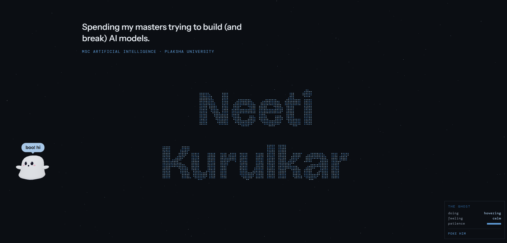

# neeti-kurulkar.github.io

My portfolio. One page, one fixed 3D scene behind it, and a ghost who lives in
the margins.

**[neeti-kurulkar.github.io](https://neeti-kurulkar.github.io/)**



## What it does

**The name is particles.** A 2D canvas samples the letterforms and holds a few
thousand points in that shape. Drag the cursor through it and they shove apart
and bruise darker; let go and they heal. Scroll past the hero and the letters
come apart and drift outward into the starfield, where they keep moving slowly
for the rest of the page.

**The ghost has moods.** He hovers in whichever gutter he is on, drifting up
and down, and crosses to the other side now and then. He is not following you.
He reacts, though:

| | |
|---|---|
| **Idle** | hovering, or crossing over |
| **Wave** | you are near him and moving gently, and he says hello |
| **Scared** | you swatted him. He drains of colour, bolts for the readout box, hides behind it for five seconds and will not be poked again until he comes back out |

He also says something as each section arrives, and comes over to the panel
when you open a project.

**It is a resume underneath all that.** Education and internships, projects
with their real figures on the face of each card, skills, achievements,
contact. Every project opens as a deep link (`/#project/injection`), so the URL
is shareable and the back button works without the 3D scene ever restarting.

## On a phone, and on a tablet

There are three tiers, decided in `src/lib/useDevice.js` and written onto
`<html data-tier>` so the stylesheet can see them too.

| | |
|---|---|
| **desktop** | everything, including the card tilt |
| **tablet** | the ghost and the swarm are both there and are driven by your finger. You poke him by tapping him. Nothing tilts, because nothing hovers. The column gives up width on both sides so that he has real gutters to stand in |
| **phone** | starfield and cards. He has nowhere to stand, so he is not mounted at all, and the `h1` stops being screen-reader-only and is set properly, since nothing is drawing the name any more |

Which tier you are is not a width: a phone held sideways is wider than a
tablet held upright, so the tablet test asks for height as well. Touch is
read from the touch events rather than the pointer ones, because a drag that
scrolls the page fires `pointercancel` and then stops reporting, and the
swarm wants the whole gesture. Nothing calls `preventDefault`, so the page
scrolls exactly as it would otherwise.

## Stack

React 19 · Vite 7 · three.js via React Three Fiber · plain CSS. No UI framework.
One 148 KB model; the starfield and sparkles are generated.

## Running it

```bash
npm install
npm run dev        # http://localhost:5173
npm run build
npm run preview
```

Every push to `main` runs `.github/workflows/deploy.yml`, which builds and
publishes to GitHub Pages. Pages → Source must be set to **GitHub Actions**.

## Where things live

| I want to change… | File |
|---|---|
| Any text, project, job, award | `src/content.js` — the single source of truth |
| Colours, type, spacing | the `:root` block in `src/styles.css` |
| The 3D scene, stars, camera | `src/three/Scene.jsx` |
| The ghost: lane, moods, lines | `src/three/Ghost.jsx` |
| The name swarm | `src/ui/NameSwarm.jsx` |
| What he says per section | `sectionLines` in `src/content.js` |
| Who gets the ghost, the swarm, the tilt | `src/lib/useDevice.js` |

## Two things that will bite you

**Never `scene.clone()` a skinned mesh.** The clone keeps the *original*
skeleton, and a skinned mesh renders from its bone matrices, so the clone
ignores its own transform and draws at the origin. `Ghost.jsx` uses the loaded
scene directly. For a second ghost, use `SkeletonUtils.clone()`.

**Keep the camera still.** The ghost's lane is computed in world units from
`viewport`. If the camera moves or rotates, those coordinates stop matching the
screen and he ends up somewhere else entirely. Parallax belongs on the
background group, not the camera.

`viewport` also describes the plane at z = 0, and he floats at z = 0.4, so
every pixel-to-world conversion in `Ghost.jsx` is scaled into his own plane
first. Skip that and he lands about three per cent further out than you asked
for — invisible in a wide desktop gutter, half off the edge on a tablet.

## Fonts

Stand-ins are in place. The intended pairing is **Boogy Brut Poster** (Bureau
Brut) over **Saans** (Displaay), both commercial. Buy the webfont licences, put
the `.woff2` files in `public/fonts`, add `@font-face` rules, then change two
lines at the top of `src/styles.css`:

```css
--f-display: 'Boogy Brut Poster', …;   /* currently Bricolage Grotesque */
--f-text:    'Saans', …;               /* currently Instrument Sans */
```

Nothing else in the project names a typeface.

## Credit — required, do not remove

The ghost is **[Cute Ghost](https://sketchfab.com/3d-models/cute-ghost-animated-idle-wave-scared-e50bb17a19d849c590bac5d66779a6c9)
by Arsyuta777**, CC BY 4.0, via Sketchfab. The credit line in the contact
section is a licence condition, not a courtesy.
